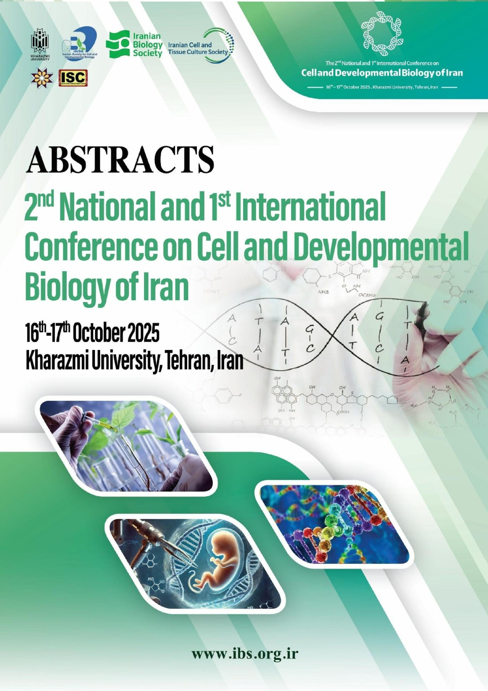

# Anatomical and Histochemical Fingerprint of the Gastrointestinal Tract in Bony Fishes from Different Trophic Levels

**Parsa Jomehpour, Seyyed Mohammad Hadi Alavi\*, Mona Dabagh, Mohammad Hossein Omidi**

Department of Animal Biology, School of Biology, College of Science, University of Tehran, Tehran, Iran
\*Corresponding author: [hadi.alavi@ut.ac.ir](mailto:hadi.alavi@ut.ac.ir)

**Oral presentation** (abstract no. 22480) at the **2nd National and 1st International Conference on Cell and Developmental Biology of Iran**, 16–17 October 2025, Kharazmi University, Tehran, Iran ([Iranian Biology Society](https://www.ibs.org.ir)). Published in the conference abstract book, p. 474.

📄 **[Published abstract (abstract book, p. 474)](conference/abstract_book_excerpt.pdf)** · [Submitted version](abstract/Jomehpour_et_al_2025_abstract.pdf) · [Full abstract book](conference/abstract_book_full.pdf)

---

## Overview

The anatomy, morphology and histology of the gastrointestinal tract (GIT) vary across species and developmental stages as an evolutionary adaptation to feeding habits. In fish, the GIT comprises the headgut (mouth and pharynx), foregut (esophagus, stomach and pyloric ceca), midgut (intestine) and hindgut (rectum). Besides digestion and nutrient uptake, it has extensive endocrine functions.

This study builds an **anatomical and histochemical fingerprint of the GIT** in fish from different trophic levels.

## Species

| Species | Common name | Feeding strategy |
|---|---|---|
| *Tinca tinca* | Tench | Omnivorous |
| *Abramis brama* | Common bream | Omnivorous |
| *Pennahia anea* | Donkey croaker | Carnivorous |

## Methods

* Sampling of the gastrointestinal tract from each species and fixation in 5 % formalin
* Dehydration and paraffin embedding
* Serial sections, 7 µm thick
* Staining with hematoxylin & eosin (H&E) and periodic acid–Schiff (PAS)
* Light microscopy, image capture, histochemical characterization and GIT morphometry

## Key findings

* Unlike *T. tinca*, a stomach was present in *A. brama* and *P. anea*; pyloric ceca were not observed in any species.
* In all species, the GIT wall consisted of mucosa, submucosa, muscularis and serosa.
* The morphometry of mucosal folds and cellular components varied along the GIT and between species.
* Gastric glands and goblet cells were common components of the stomach and the post-gastric region, respectively, with higher numbers in the anterior stomach and the posterior intestine.
* Histochemical traits were tightly aligned with feeding behavior.

The study quantifies histological features of the GIT, maps the spatial distribution of its cellular components, provides a framework for understanding trophic specialization, and expands insight into the evolution of the digestive system.

**Keywords:** gastric cells, goblet cells, intestine, mucosal folds, stomach

## Repository contents

```
.
├── abstract/
│   └── Jomehpour_et_al_2025_abstract.pdf   # abstract as submitted
├── conference/
│   ├── abstract_book_excerpt.pdf           # cover + published abstract (p. 474)
│   ├── abstract_book_full.pdf              # complete conference abstract book (635 pages)
│   └── abstract_book_cover.jpg             # cover of the abstract book
└── README.md
```

## Citation

Jomehpour, P., Alavi, S. M. H., Dabagh, M., & Omidi, M. H. (2025). *Anatomical and histochemical fingerprint of gastrointestinal tract in bony fishes from different trophic levels* [Oral presentation, abstract no. 22480]. 2nd National and 1st International Conference on Cell and Developmental Biology of Iran, Kharazmi University, Tehran, Iran. Abstract book, p. 474.

*Note:* the author order above follows the published abstract book; the submitted version lists the authors in a different order.

<p align="center"></p>
